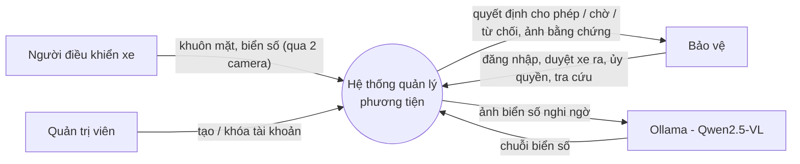
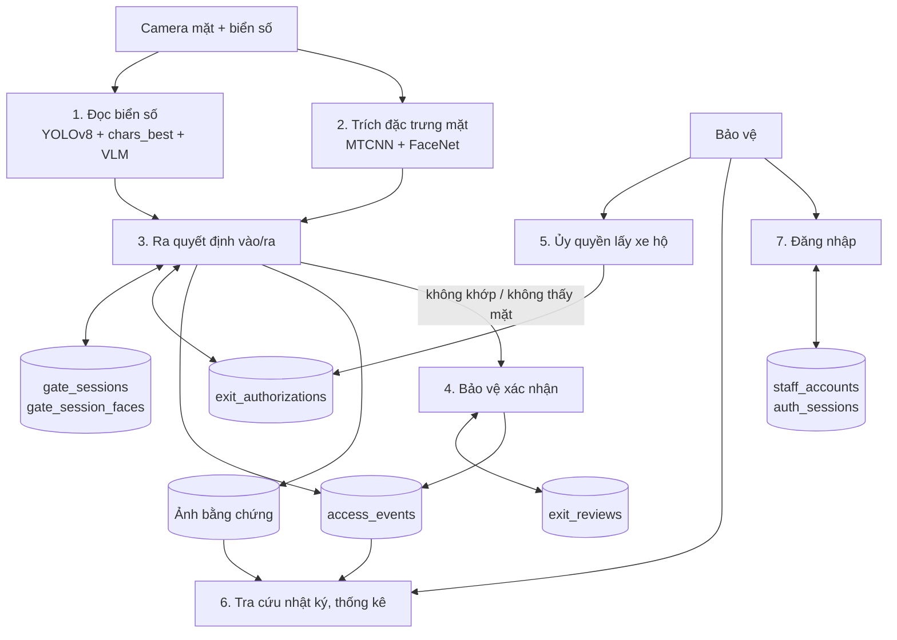
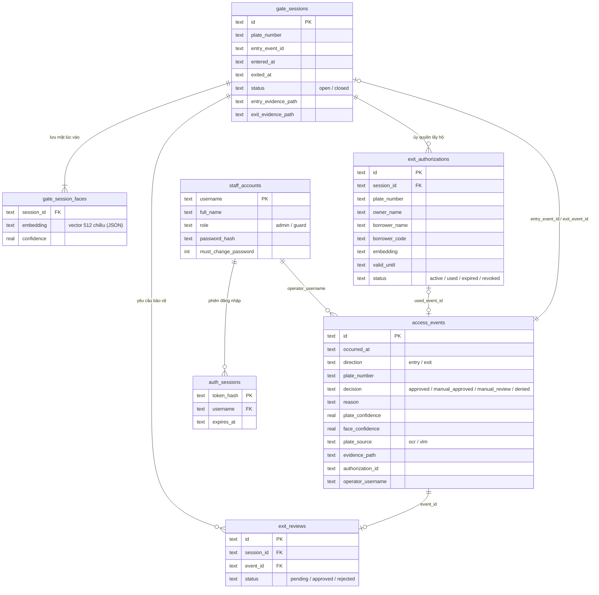
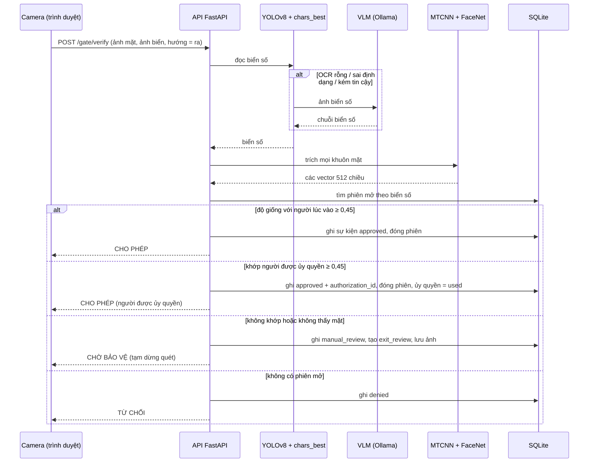

# Nháp nội dung cập nhật cho quyển báo cáo

Tài liệu này liệt kê những chỗ quyển `Bao_cao_do_an_4_chuong.docx` đang lệch so với mã nguồn hiện tại và gợi ý nội dung thay thế. Đây là **bản nháp tham khảo**: sinh viên tự viết lại bằng lời văn của mình, kiểm tra số liệu với tệp kết quả gốc trước khi đưa vào báo cáo.

## 0. Những chỗ cần sửa (theo thứ tự ưu tiên)

| Vị trí trong báo cáo | Hiện ghi | Cần sửa thành |
|---|---|---|
| Mục 2.3.3 "Dự phòng bằng EasyOCR và chuẩn hóa", Bảng ngưỡng EasyOCR, mục 1.x OCR, tài liệu tham khảo [5] | EasyOCR là tầng dự phòng | Tầng dự phòng là VLM Qwen2.5-VL 3B qua Ollama (mục 1 bên dưới). EasyOCR đã bỏ khỏi `requirements.txt` |
| Mục 4.3 | "22/22 bài kiểm thử API… thư mục dự án chưa có bộ tests tương ứng" | 56/56 bài, chạy lại được bằng một lệnh (mục 3) |
| Mục 4.4 | "Ngưỡng 0,45 chưa được hiệu chỉnh bằng cặp cùng người và khác người" | Đã đánh giá trên LFW 6.000 cặp (mục 2) |
| Mục 3.5.5 | Ủy quyền/mượn xe "không mô tả… như chức năng" | Đã có chức năng ủy quyền lấy xe hộ (mục 4), bảng mới `exit_authorizations` |
| Chương 3 | Có Use Case, thiếu DFD, ERD, sơ đồ tuần tự (đề cương tuần 5 yêu cầu) | Thêm ba sơ đồ ở mục 6 |
| Chương 3/4 | Giao diện 4 mục, tên bảo vệ nhập tay, không phân quyền | 6 mục, đăng nhập, phân quyền admin/bảo vệ (mục 5) |
| Bố cục | Đề cương ghi 5 chương (có Chương 5 Kết luận) | Hỏi GVHD: giữ 4 chương hay tách "Kết luận và hướng phát triển" thành Chương 5 như đề cương |

## 1. Đọc biển số ba tầng: YOLOv8 → chars_best → VLM

**Luồng.** YOLOv8 (`license_plate.pt`, mAP@50 = 0,970) tìm vùng biển số. Mô hình ký tự `chars_best.pt` đọc từng ký tự, sắp theo hàng (biển 2 dòng) rồi ghép chuỗi. VLM Qwen2.5-VL 3B (chạy cục bộ qua Ollama, lượng tử Q4_K_M, khoảng 3,2 GB) chỉ được gọi khi:

1. OCR không ra chuỗi; hoặc
2. chuỗi sai định dạng biển Việt Nam `^\d{2}[A-Z][A-Z0-9]?\d{4,5}$`; hoặc
3. chuỗi đúng định dạng nhưng có ký tự độ tin cậy < 0,5.

Nếu VLM trả biển hợp lệ thì dùng kết quả VLM, ngược lại giữ kết quả OCR. Ollama tắt hoặc chưa cài thì hệ thống chạy bằng OCR, không báo lỗi. Nhật ký lưu cột `plate_source` (`ocr`/`vlm`).

**Kết quả** (tập test 69 ảnh, bỏ 7 ảnh biển bị cắt): OCR 49/69 = 71,0 %; kết hợp 63/69 = **91,3 %**. Trên 66 ảnh biển rõ: 72,7 % → 92,4 %. Thời gian trung vị 144 ms/ảnh; VLM được gọi ở 17/76 ảnh, mỗi lần khoảng 1,7–2 s trên GPU.

**Vì sao không dùng VLM cho mọi ảnh.** VLM chậm hơn khoảng 15 lần. Phần lớn biển OCR đọc đúng với độ tin cậy cao, nên chỉ hỏi VLM khi nghi ngờ thì giữ được tốc độ ở cổng.

**Sự cố và cách xử lý.** Với Ollama 0.40.18, một số ảnh làm runner rơi vào trạng thái hỏng: mọi câu trả lời sau đó là chuỗi `888…`. Hệ thống phát hiện ký tự lặp ≥ 12 lần, gỡ model khỏi bộ nhớ (`keep_alive = 0`) rồi đọc lại bằng PNG. Trên 60 lượt đọc liên tiếp: trước khi sửa 32 lượt hỏng, sau khi sửa 0.

**Hạn chế.** Hai biển OCR đọc sai một ký tự nhưng vẫn đúng định dạng (`51H09488` → `51H09468`, `53X74327` → `53X794327`) được gửi cho VLM nhưng VLM cũng không đọc đúng (ảnh có hai biển, ký tự mờ). Biển bị cắt mất phần (7 ảnh) không đọc được.

## 2. Đối chiếu khuôn mặt và ngưỡng 0,45

MTCNN tìm **mọi** khuôn mặt trong khung hình, FaceNet (InceptionResnetV1, VGGFace2) tạo vector 512 chiều đã chuẩn hóa L2. Lúc ra, hệ thống lấy độ giống cosine **lớn nhất** giữa các mặt hiện tại và các mặt đã lưu lúc vào của cùng biển số.

Đánh giá trên LFW (6.000 cặp chuẩn, 10-fold): độ chính xác 98,90 % ± 0,65 %, AUC 0,9989. Tại ngưỡng 0,45: độ chính xác 98,95 %, FAR 0,37 %, FRR 1,73 %; ngưỡng tối ưu theo độ chính xác là 0,43 (FAR 0,50 %). Chọn 0,45 vì để người lạ lấy xe nguy hiểm hơn chủ xe phải chờ bảo vệ. Cách "lấy mọi mặt, chọn độ giống lớn nhất" giảm chặn nhầm từ 7,1 % (chỉ lấy một mặt) xuống 1,7 %. Ngưỡng nay cấu hình được bằng biến `FACE_MATCH_THRESHOLD`.

Hạn chế: LFW không có mũ bảo hiểm, khẩu trang; cần đo lại tại cổng trường.

## 3. Kiểm thử

`pytest` 56 bài (23 bài API nghiệp vụ, 23 bài client VLM, 10 bài luật kết hợp OCR + VLM), khoảng 15 s, không cần GPU. Bài API dùng AI giả lập để kiểm chứng logic quyết định: vào/ra, người lạ, bảo vệ duyệt, ủy quyền, đăng nhập, dữ liệu lỗi, đồng thời, khôi phục sau khởi động lại. Bảng chi tiết: `docs/KET_QUA_KIEM_THU.md`. Có thể đưa nguyên bảng nhóm kịch bản vào mục 4.3.

Chạy thật với mô hình thật: chủ xe ra (độ giống 0,90) được cho phép; người khác (0,04) chờ bảo vệ; người được ủy quyền (0,64) được cho phép; mỗi lượt quét khoảng 0,2 s khi không cần VLM.

## 4. Ủy quyền lấy xe hộ (xe mượn) — đáp ứng "tính mới" trong đề cương

**Bài toán.** Chủ xe A gửi xe rồi nhờ bạn C lấy xe ra. Theo luật "người ra phải khớp người vào", C sẽ bị chặn.

**Giải pháp.** Khi xe đang ở trong bãi, bảo vệ (đã đăng nhập) xác minh với A (gặp trực tiếp/gọi điện), ghi tên A, tên và MSSV/CCCD của C, chụp mặt C. Ủy quyền gắn với **đúng lượt gửi xe** đang mở, có thời hạn (mặc định 4 giờ, tối đa 24 giờ) và **chỉ dùng một lần**. Lúc ra: nếu mặt không khớp người lúc vào, hệ thống so tiếp với các ủy quyền còn hiệu lực của lượt đó; khớp ≥ ngưỡng thì cho phép với lý do "Người được ủy quyền lấy xe: C (MSSV) · Chủ xe: A". Ủy quyền chuyển sang "đã dùng". Chủ xe tự lấy xe thì các ủy quyền chưa dùng hết hiệu lực. Bảo vệ có thể hủy ủy quyền.

Tại sao gắn với lượt gửi xe thay vì với biển số: ủy quyền không bị dùng lại cho những lần gửi xe sau, giảm rủi ro "ủy quyền vĩnh viễn".

## 5. Đăng nhập và phân quyền

- Hai vai trò: **quản trị viên** (tạo/khóa tài khoản) và **bảo vệ**. Lần đầu tạo `admin`, bắt buộc đổi mật khẩu.
- Mật khẩu băm PBKDF2-SHA256 200.000 vòng, có salt. Phiên đăng nhập là cookie HttpOnly, SameSite=Lax, 12 giờ; trong cơ sở dữ liệu chỉ lưu SHA-256 của token.
- Mọi API nghiệp vụ và ảnh bằng chứng (có khuôn mặt — dữ liệu cá nhân) yêu cầu đăng nhập. Chỉ `/health` và `/model/status` công khai.
- Người duyệt xe ra, ghi ngoại lệ, tạo ủy quyền được ghi theo tài khoản (`operator_username`), không còn nhập tên tay.
- Ảnh tải lên giới hạn 10 MB, kiểm tra giải mã trước khi lưu.

## 6. Sơ đồ bổ sung cho Chương 3

Các sơ đồ viết bằng Mermaid; dán vào https://mermaid.live để xuất ảnh PNG/SVG rồi chèn vào Word.

### 6.1 DFD mức ngữ cảnh

### 6.2 DFD mức 1

### 6.3 ERD (các bảng đang dùng)

Các bảng `people`, `vehicles`, `vehicle_authorizations`, `vehicle_sessions`, `vehicle_session_people` còn trong lược đồ từ thiết kế ban đầu (đăng ký xe trước) nhưng không được dùng; có thể nêu ở mục "hướng phát triển: tích hợp hệ thống sinh viên".

### 6.4 Sơ đồ tuần tự — xe ra

## 7. Hướng phát triển (gợi ý cho chương kết luận)

- Thu thập ảnh thật tại cổng trường (có sự đồng ý) để đo lại cả biển số và khuôn mặt; thử mũ bảo hiểm, khẩu trang, ban đêm.
- Tích hợp danh sách sinh viên/xe đăng ký để chủ xe tự tạo ủy quyền trên cổng thông tin sinh viên thay vì qua bảo vệ.
- Điều khiển thanh chắn thật (IoT), chạy hai làn đồng thời, triển khai HTTPS.
- Thử ArcFace (đã có so sánh trong `02_Ket_qua_so_sanh_model`) hoặc tinh chỉnh ngưỡng theo dữ liệu thật.
