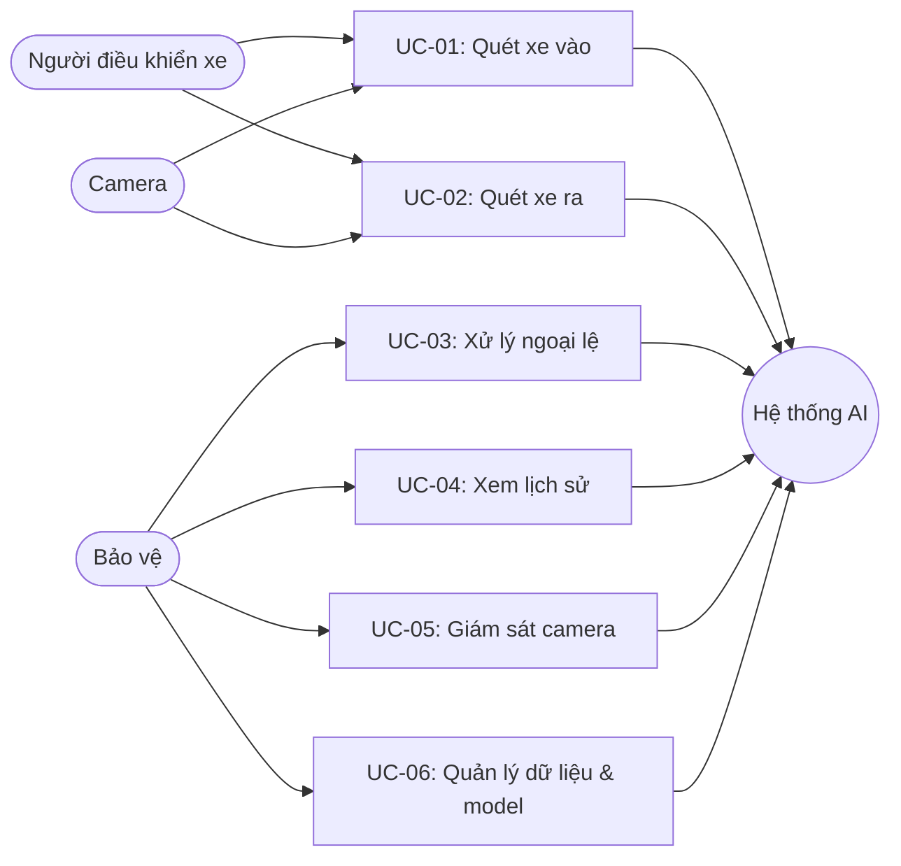

# Use case — Hệ thống kiểm soát xe ra vào bằng AI

## 1. Tác nhân

| Tác nhân | Vai trò |
| --- | --- |
| Người điều khiển xe | Đi xe vào hoặc ra cổng trường. |
| Bảo vệ | Giám sát kết quả AI, xử lý ngoại lệ và kiểm tra lịch sử. |
| Camera | Cung cấp luồng hình ảnh khuôn mặt và biển số. |
| Hệ thống AI | Phát hiện khuôn mặt, đọc biển số, đối chiếu lượt vào/ra và lưu nhật ký. |

## 2. Sơ đồ use case tổng quan

## UC-01 — Tự động quét xe vào

| Mục | Nội dung |
| --- | --- |
| Tác nhân chính | Người điều khiển xe, Camera |
| Mục tiêu | Ghi nhận biển số và khuôn mặt của người đi cùng xe khi vào trường. |
| Điều kiện trước | Camera hoạt động; xe đi vào vùng quan sát. |
| Kết quả | Hệ thống tạo lượt xe vào, lưu biển số, đặc trưng khuôn mặt và ảnh bằng chứng. |

**Luồng chính**

1. Camera lối vào gửi hình ảnh liên tục cho hệ thống.
2. AI phát hiện khuôn mặt và biển số xe.
3. Hệ thống đọc biển số, lưu khuôn mặt của người lái/người đi cùng.
4. Hệ thống tạo phiên gửi xe ở trạng thái “đang trong bãi”.
5. Màn hình hiển thị cho phép xe vào và ảnh quét tại lối vào.

**Ngoại lệ**

- Không đọc được biển số hoặc không phát hiện được khuôn mặt: hệ thống chờ khung hình rõ hơn, không ghi hàng loạt lỗi.
- Camera/kết nối lỗi: chuyển sang UC-03.

## UC-02 — Tự động xác minh xe ra

| Mục | Nội dung |
| --- | --- |
| Tác nhân chính | Người điều khiển xe, Camera |
| Mục tiêu | Chỉ cho xe ra khi người hiện tại khớp với một người đã đi vào cùng xe. |
| Điều kiện trước | Có một lượt xe vào đang mở với cùng biển số. |
| Kết quả | Cho phép hoặc giữ xe để bảo vệ kiểm tra. |

**Luồng chính**

1. Camera lối ra quét khuôn mặt và biển số.
2. AI tìm lượt xe vào chưa đóng có cùng biển số.
3. Hệ thống so sánh khuôn mặt hiện tại với tất cả khuôn mặt đã lưu lúc vào.
4. Nếu điểm tương đồng đạt ngưỡng, hệ thống đóng lượt xe và cho phép ra.
5. Nhật ký lưu quyết định, thời gian và ảnh bằng chứng lúc ra.

**Ngoại lệ**

- Không tồn tại lượt xe vào: giữ xe để kiểm tra.
- Khuôn mặt không khớp: không cho xe ra và yêu cầu bảo vệ xác minh.
- Ảnh không rõ: tiếp tục quét các khung hình tiếp theo.

## UC-03 — Xử lý ngoại lệ không quét AI

| Mục | Nội dung |
| --- | --- |
| Tác nhân chính | Bảo vệ |
| Mục tiêu | Xử lý trường hợp không thể hoặc không cần áp dụng AI nhưng vẫn truy vết được. |
| Điều kiện trước | Bảo vệ xác định thuộc một trường hợp ngoại lệ. |
| Kết quả | Một nhật ký “Xử lý thủ công” được lưu, không bị coi là lượt AI từ chối. |

**Luồng chính**

1. Bảo vệ mở mục **Xử lý ngoại lệ**.
2. Chọn hướng đi: lối vào hoặc lối ra.
3. Chọn lý do: người đi bộ, xe ưu tiên/tình huống khẩn cấp, camera/AI gặp sự cố, hoặc bảo vệ xác nhận thủ công.
4. Nhập người xử lý và ghi chú nếu cần.
5. Hệ thống lưu thời gian, lý do và người xử lý vào nhật ký.

## UC-04 — Tra cứu nhật ký kiểm soát

| Mục | Nội dung |
| --- | --- |
| Tác nhân chính | Bảo vệ |
| Mục tiêu | Xem lại các lượt xe, kết quả AI và các trường hợp ngoại lệ. |
| Điều kiện trước | Có dữ liệu trong nhật ký. |
| Kết quả | Hiển thị thời gian, hướng đi, biển số, quyết định, ảnh bằng chứng và ghi chú. |

**Luồng chính**

1. Bảo vệ mở mục **Nhật ký**.
2. Chọn khoảng thời gian cần tra cứu.
3. Hệ thống lọc và hiển thị các lượt phù hợp.
4. Bảo vệ xem trạng thái: cho phép, từ chối hoặc xử lý thủ công.

## UC-05 — Giám sát camera thời gian thực

| Mục | Nội dung |
| --- | --- |
| Tác nhân chính | Bảo vệ, Camera |
| Mục tiêu | Theo dõi đồng thời camera lối vào và lối ra. |
| Điều kiện trước | Trình duyệt được cấp quyền dùng camera. |
| Kết quả | Hiển thị luồng live, khung khuôn mặt và ảnh chụp sau khi quét thành công. |

**Luồng chính**

1. Bảo vệ chọn camera cho lối vào và lối ra.
2. Hệ thống mở hai luồng camera.
3. AI tự động quét theo chu kỳ và cập nhật kết quả trên giao diện.
4. Bảo vệ có thể tạm dừng hoặc khởi động lại quét khi cần.

## UC-06 — Theo dõi dữ liệu và model

| Mục | Nội dung |
| --- | --- |
| Tác nhân chính | Quản trị viên/Bảo vệ được phân quyền |
| Mục tiêu | Theo dõi chất lượng model và bổ sung dữ liệu phục vụ cải thiện hệ thống. |
| Điều kiện trước | Người dùng có quyền thao tác khu vực Dữ liệu & Model. |
| Kết quả | Ảnh được thêm vào dataset; hiển thị Precision, Recall và mAP@50 của model. |

**Luồng chính**

1. Người quản trị chọn ảnh xe/biển số thực tế.
2. Nhập hoặc bổ sung biển số để gán nhãn.
3. Hệ thống lưu ảnh vào dataset cục bộ.
4. Người quản trị theo dõi các chỉ số đánh giá của model đã train.
