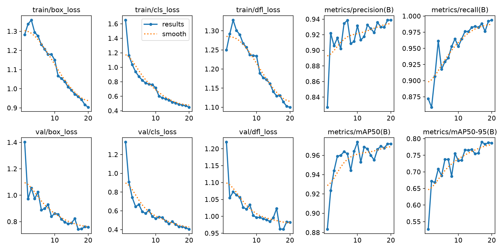
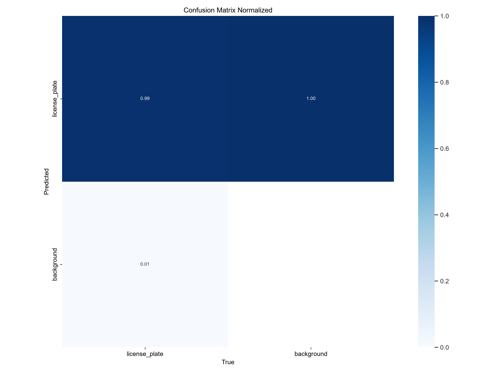
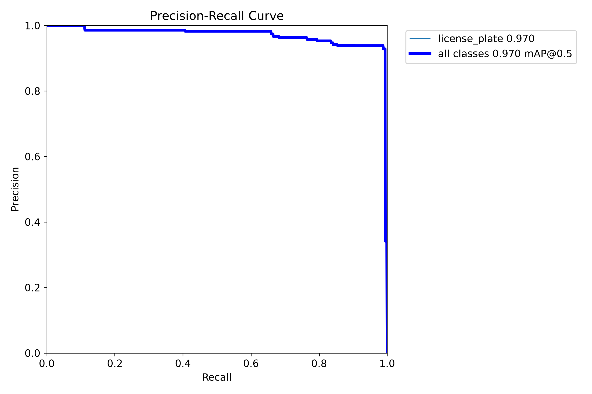
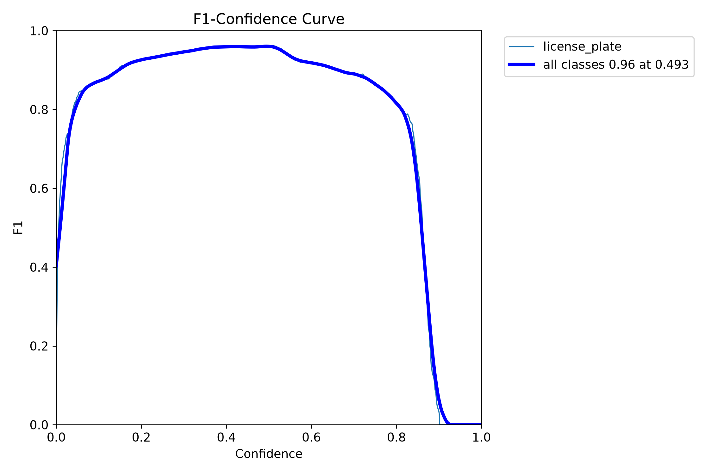
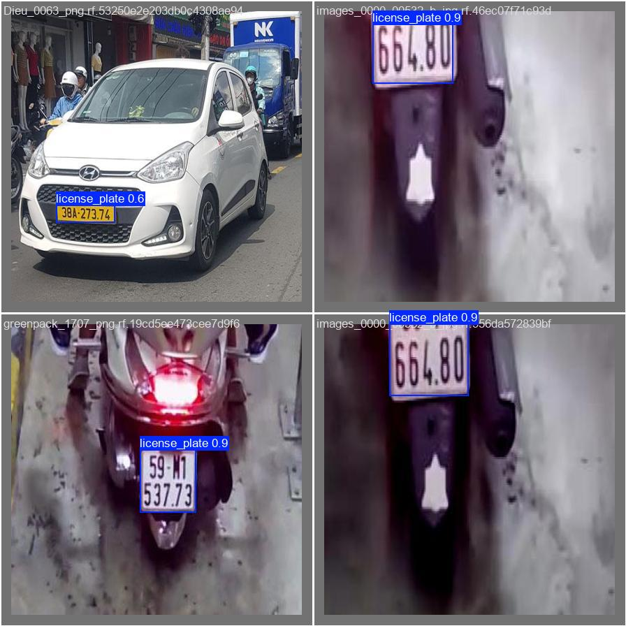

# Kết quả huấn luyện model biển số Việt Nam

Model YOLOv8 được huấn luyện 20 epoch với 2.814 ảnh train và đánh giá trên 159 ảnh validation.

| Chỉ số | Kết quả |
| --- | ---: |
| Precision | 93.0% |
| Recall | 98.8% |
| mAP@50 | 97.0% |

## 1. Tiến trình model học qua 20 epoch

Biểu đồ thể hiện các chỉ số và lỗi (loss) thay đổi qua từng vòng học. Các đường biểu đồ ổn định dần cho thấy model đã học được đặc điểm biển số.

## 2. Model nhận diện đúng/sai biển số

Ma trận nhầm lẫn cho biết số lượng biển số model phát hiện đúng và các trường hợp bị nhầm hoặc bỏ sót trên tập validation.

## 3. Độ chính xác khi thay đổi ngưỡng nhận diện

Đường cong này cho thấy sự cân bằng giữa việc nhận diện đúng biển số và việc không bỏ sót biển số khi thay đổi ngưỡng tin cậy.

## 4. Ngưỡng nhận diện tốt nhất của model

Biểu đồ cho biết ngưỡng tin cậy có điểm F1 cao nhất, tức là cân bằng tốt nhất giữa Precision và Recall.

## 5. Kết quả model dự đoán biển số

Đây là ảnh thực tế từ tập kiểm tra. Khung bao quanh biển số là kết quả model YOLOv8 đã dự đoán.

Các tệp trọng số model, dataset và ảnh camera không được đưa lên Git để tránh repository quá nặng và bảo vệ dữ liệu thực tế.
